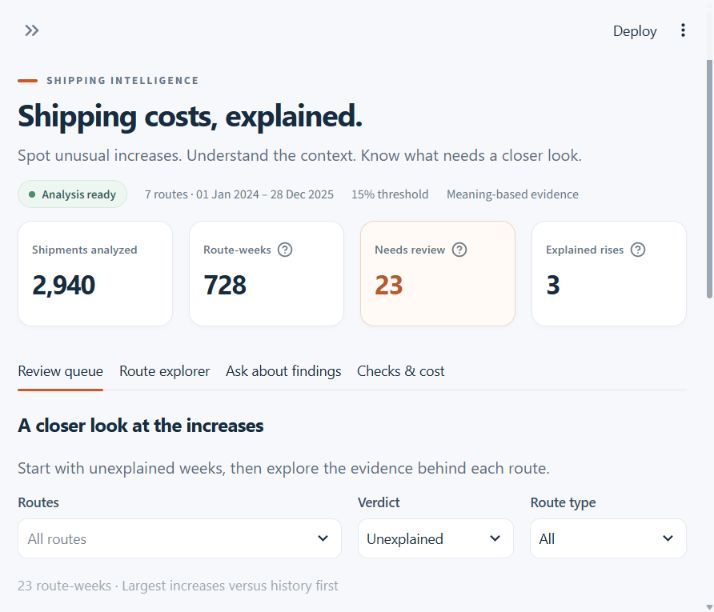
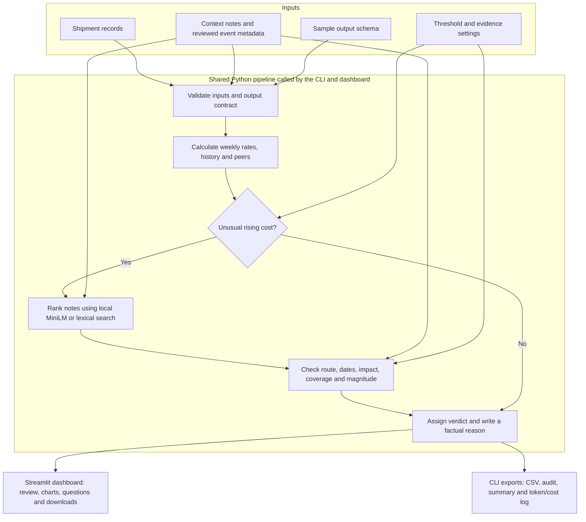

# Freight Cost Monitor

A local application for finding unusual weekly freight costs and checking whether the available context explains them. Built for the FreightTiger internship case study using the supplied shipment records and context notes.

The app answers three questions: **Where did costs rise? How unusual is the rise? Is there evidence that explains it?** Each result includes measured comparisons and a reason that can be checked against the original notes.

[Architecture](#high-level-architecture) · [Run locally](#run-locally) · [Analysis rules](#how-the-analysis-works) · [Outputs](#outputs) · [Validation](#validation-and-reproducibility) · [Design decisions](decisions.md)



## What you can do

- Review unusual route-weeks and filter by route, route type or verdict.
- Compare weekly rates with a route's own history and similar routes.
- Inspect supporting notes, event dates and rejected evidence.
- Ask questions such as **“Why did Chennai-Bangalore get pricier in March 2025?”**
- Change the anomaly threshold or retrieval mode and download the complete submission CSV.

The project uses a local sentence encoder for semantic retrieval. Calculations, evidence checks, verdicts and explanation text follow explicit rules. It does not call a generative LLM or require an API key.

## High-level architecture



[`pipeline.py`](freight_assistant/pipeline.py) is the common entry point, so the UI and CLI use the same calculations and evidence rules. Only anomaly candidates enter note retrieval. Normal rows still receive their own measured explanation and appear in the export.

Retrieval ranks the ten supplied notes; every ranked note is then checked. A high similarity score alone cannot justify a rise. Source hashes and reviewed annotations connect accepted explanations to exact quotes and applicable event windows. Evaluation and reproducibility reports are generated separately by the validation commands below.

## Run locally

### Requirements

- Python **3.12 or 3.14**, the versions exercised during development.
- Git and, optionally, VS Code.
- Internet access for installing dependencies and downloading the semantic model the first time.

These commands use **Windows PowerShell** and call the virtual environment directly, so activating it is optional.

```powershell
git clone https://github.com/AnanyaSingh2305/Freight_cost.git
cd Freight_cost
python -m venv .venv
.\.venv\Scripts\python.exe -m pip install -r requirements.txt
.\.venv\Scripts\python.exe -m freight_assistant
.\.venv\Scripts\python.exe -m streamlit run app.py
```

Open **[http://127.0.0.1:8501](http://127.0.0.1:8501)** after Streamlit starts. The analysis command regenerates the files in `results/` before the dashboard opens.

The first semantic analysis downloads the pinned `sentence-transformers/all-MiniLM-L6-v2` model into `.cache/models/`. Model weights and virtual environments are excluded from Git. To reproduce the full tested dependency set, install `requirements-lock.txt` instead of `requirements.txt` in a fresh environment.

### Launch from VS Code

Open this repository folder, install the recommended Python and Python Debugger extensions, then select **Run and Debug → FreightTiger: live dashboard → F5**. Alternatively, use **Terminal → Run Task → FreightTiger: run dashboard** or run `./run_demo.ps1` after installing dependencies. Reuse an existing server on port 8501 or stop it before starting another copy.

### Work offline

Once the model has been downloaded, semantic analysis can run without network access:

```powershell
.\.venv\Scripts\python.exe -m freight_assistant --offline
```

For analysis without downloading a model, use the explicit lexical baseline. Its CLI path uses Python's standard library:

```powershell
.\.venv\Scripts\python.exe -m freight_assistant --retriever lexical --output-dir results/lexical
```

Lexical mode uses TF-IDF and cosine similarity. Semantic mode uses the local encoder through ONNX Runtime and Hugging Face Tokenizers. A failed semantic run reports an error rather than silently switching modes.

## Using the dashboard

1. Set **Unusual increase threshold (%)** and choose an **Evidence search** mode.
2. Click **Run analysis** to apply those settings. Editing a form field alone does not update the results.
3. Start in **Review queue** to inspect unexplained weeks. Use **Route explorer** to see the trend and a selected week's explanation.
4. Use **Ask about findings** for one named route and, optionally, a month and year. This is a constrained query over computed results.
5. Open **Checks & cost** for the comparison basis, active configuration and usage details. Use **Download complete submission CSV** for all route-weeks, including normal rows.

Changing dashboard settings updates that session and its download. To regenerate the saved submission files, run the CLI with the desired configuration.

## How the analysis works

### Weekly rate and comparison baselines

Routes are directed origin–destination pairs. The supplied `route_type` determines the peer group. Weeks run **Monday through Sunday**, with `week_of` set to Monday.

```text
weekly cost per tonne-km = sum(freight_cost_inr)
                          / sum(quantity_tonnes × distance_km)

percentage difference = 100 × (current rate / baseline − 1)
```

| Comparison | Definition |
| --- | --- |
| Own history | Arithmetic mean of available weekly rates in the previous eight calendar weeks. The current week is excluded. |
| Similar routes | Arithmetic mean of other routes' rates in the same week and supplied route type. The selected route is excluded. |
| Previous observed week | The route's most recent earlier observation, used as an additional check that costs are rising. |

Missing weeks are not filled with zeros or replaced by older observations. Missing or zero baselines have an undefined percentage, shown as `N/A` in the CSV. A positive rate after a zero historical baseline is still treated as a rise. Calculations keep full precision; exported costs use two decimals and comparisons use one decimal.

### Detection and evidence

At the default setting, a route-week becomes a candidate when it is **at least 15% above history or peers**, and also shows a positive rise versus history or the previous observed week. The threshold is an implementation assumption because the brief does not prescribe one. See [`decisions.md`](decisions.md) for the rationale and edge cases.

Candidate notes must pass route applicability, publication/event dates, cost impact, shipment coverage and any stated magnitude limits. By default, at least **75% of the week's shipment tonne-km** must fall within the supported event window and on or after the note's publication date. A quantified note has a **two-percentage-point magnitude tolerance**. These controls live in [`config.json`](config.json).

A nationwide increase cannot explain a route-specific premium over peers. An expired disruption cannot explain shipments after its event window. New or altered notes require reviewed annotations before they can justify a verdict.

| Setting in `config.json` | Default | Purpose |
| --- | ---: | --- |
| `anomaly_threshold_pct` | `15.0` | Minimum uplift against history or peers. |
| `minimum_rise_pct` | `0.0` | Rise must exceed this value against history or the previous observed week. |
| `minimum_evidence_coverage` | `0.75` | Minimum share of shipment tonne-km supported by an event. |
| `magnitude_tolerance_pct` | `2.0` | Percentage-point allowance when checking a quantified note. |

| CSV `flagged` value | Meaning |
| --- | --- |
| `No` | No unusual rising cost under the active policy. |
| `Yes` | Unusual rise with insufficient supporting evidence. Review is needed. |
| `No (justified)` | Unusual rise supported by applicable context. |

Justified rows include an exact source quote, note ID, event dates and shipment coverage. Unexplained rows keep `matched_note_id` blank. Reasons include each route-week's measurements and relevant evidence failures; they do not invent causes to make the wording different. Supporting context does not establish the precise causal amount of a rise.

## Results on the supplied data

The checked-in run uses semantic retrieval and the default 15% threshold:

| Measure | Result |
| --- | ---: |
| Shipments | 2,940 |
| Directed routes | 7 |
| Route-weeks | 728 |
| Unusual rising-cost candidates | 26 |
| Supported by context | 3 |
| Unexplained and flagged | 23 |
| Normal route-weeks | 702 |

The supported weeks are Ahmedabad–Mumbai on **20 January 2025** (festival surcharge, N002) and Chennai–Bangalore on **24 February and 3 March 2025** (flood disruption, N001). Later March shipments do not inherit the expired flood explanation.

Candidate counts change from **81 at 10%**, to **26 at 15%**, to **19 at 20%**. These are sensitivity results, not accuracy scores. See [`results/summary.json`](results/summary.json).

## Outputs

The submission preserves the sample's eight columns and ordering:

```text
route,week_of,cost_per_tonne_km,vs_own_history,vs_similar_routes,flagged,matched_note_id,reason
```

| File | What it contains |
| --- | --- |
| [`results/analysis_output.csv`](results/analysis_output.csv) | Every observed route-week and its final explanation. |
| [`results/audit.json`](results/audit.json) | Full-precision metrics, candidate flags, note checks, source/input hashes and environment details. |
| [`results/summary.json`](results/summary.json) | Counts and threshold sensitivity. |
| [`results/token_cost_log.json`](results/token_cost_log.json) | Actual encoder input tokens, inference batches, runtime, cache status and API cost. |
| [`results/evaluation.json`](results/evaluation.json) | Unit-test results and labeled evidence checks. |
| [`results/reproducibility.json`](results/reproducibility.json) | CSV and audit hashes from three independent processes. |
| [`results/encoder_verification.json`](results/encoder_verification.json) | ONNX embedding comparison with independent Sentence Transformers reference vectors. |
| [`results/dashboard_checks.json`](results/dashboard_checks.json) | Streamlit interaction and explanation-refresh checks. |
| [`results/explanation_checks.json`](results/explanation_checks.json) | Verification that the explanation update preserved all other export fields. |
| [`results/robustness_checks.json`](results/robustness_checks.json) | Recovery checks for stale inputs, corrupt saved JSON and configuration changes. |

There are zero generative LLM calls and no billed API inference. Encoder tokens are counted separately from generated text tokens. Local compute, storage and initial model downloads still consume resources; model download/setup time is excluded from the per-analysis runtime log.

## Validation and reproducibility

After installing dependencies and downloading the semantic model, run:

```powershell
.\.venv\Scripts\python.exe -m unittest discover -s tests -v
.\.venv\Scripts\python.exe -m freight_assistant.evaluate --offline
.\.venv\Scripts\python.exe -m freight_assistant.reproduce --offline
.\.venv\Scripts\python.exe -m freight_assistant.verify_encoder
.\.venv\Scripts\python.exe scripts/check_dashboard.py
.\.venv\Scripts\python.exe scripts/audit_dashboard.py
```

The checked-in reports record **63 passing tests**, **20 passing evidence-suitability cases**, **nine dashboard workflow checks**, **six failure-recovery checks**, and identical CSV/audit hashes across **three fresh processes** in the tested environment. Coverage includes weighted rates, calendar gaps, no future-data leakage, peer exclusion, zero baselines, expired/future notes, partial-week coverage and nationwide-versus-peer confusion. The three supplied sample rows also match the expected numeric values, flags and note IDs.

The [project audit](AUDIT.md) records the reproduced failures and their fixes: stale input caches, exact-threshold rounding, malformed metadata/configuration, corrupt saved reports, invalid vector caches and numerical overflow. The supplied-data CSV remains byte-for-byte unchanged after these fixes.

The evidence cases are development checks, not an independent held-out benchmark. The supplied data has no complete anomaly ground truth, so the project does not claim overall anomaly precision or recall. Reproducibility comparisons use the same inputs, code, configuration, model and environment; runtime/cache logs are kept outside the deterministic audit comparison.

## Repository guide

```text
app.py                    Streamlit dashboard
assets/dashboard.css      Dashboard styling
freight_assistant/
  validation.py           Input and output-contract validation
  metrics.py              Weekly rates and comparison baselines
  detection.py            Configurable candidate policy
  retrieval.py            Semantic and lexical note ranking
  download_model.py       Pinned model download and hash manifest
  evidence.py             Source validation and evidence checks
  explanations.py         Measured, route-specific reason text
  pipeline.py             Shared analysis and export workflow
  dashboard_state.py      Input fingerprints and saved-result validation
  reporting.py            CSV and JSON serialization
  questions.py            Route/month questions over computed rows
  evaluate.py             Labeled cases and unit-test runner
  reproduce.py            Three-process reproducibility check
  verify_encoder.py       Independent embedding parity check
data/                     Supplied CSVs and reviewed note metadata
evaluation/               Evidence cases and reference embeddings
tests/                    Numerical, evidence and pipeline tests
scripts/check_dashboard.py Dashboard interaction checks
scripts/audit_dashboard.py Isolated dashboard failure-recovery checks
results/                  Saved analysis and validation reports
config.json               Detection and evidence defaults
decisions.md              Design choices, tradeoffs and limitations
AUDIT.md                  Audit findings, fixes and validation scope
WALKTHROUGH.md             Ten-minute demonstration guide
```

## Scope and next steps

This is a local case-study application with ten reviewed notes and file-based inputs. It has no production ingestion service, user authentication, database or unrestricted chatbot. New notes need a reviewed extraction/annotation workflow. A production extension would also need labeled operational data for threshold calibration, monitoring, access controls and evaluation on unseen events. The current design choices and their tradeoffs are documented in [`decisions.md`](decisions.md).
